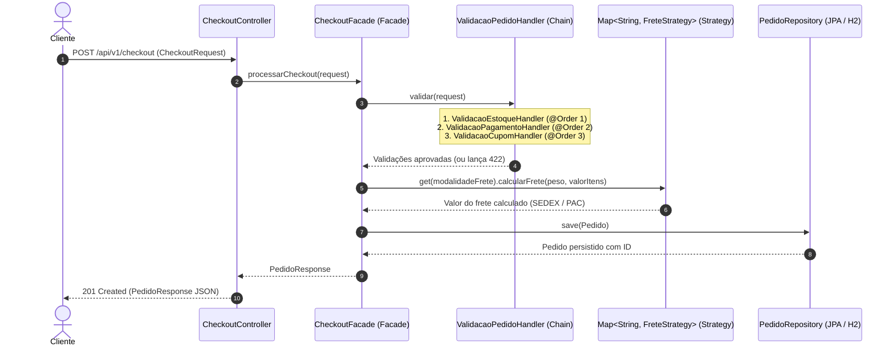

# E-commerce Checkout API — Design Patterns (GoF) & SOLID na Prática


API RESTful de **Checkout de E-commerce** projetada como referência arquitetural para demonstrar como **Padrões de Projeto (Gang of Four — GoF)** e os princípios **SOLID** resolvem problemas reais de acoplamento, extensibilidade e manutenção em aplicações **Java 21** com **Spring Boot 3**.

---

## Contexto: Desafio de Projeto DIO

Construído para o desafio ***Explorando Padrões de Projetos na Prática com Java*** da **Digital Innovation One (DIO)**, este projeto substitui exemplos artificiais por um cenário crítico do mundo real: **o fechamento de pedidos (Checkout) em um E-commerce**.

### O Problema Arquitetural Comum (Anti-Pattern)
Em sistemas legados ou sem arquitetura definida, o serviço de checkout rapidamente se torna uma *God Class* repleta de problemas:
1. **Controllers acoplados** a múltiplos serviços (`EstoqueService`, `PagamentoService`, `CupomService`, `FreteService`, `PedidoRepository`).
2. **Cadeias gigantes de `if/else` ou `switch`** para calcular o frete de cada transportadora (`SEDEX`, `PAC`, `MOTOBOY`...).
3. **Validações monolíticas** misturadas ao cálculo financeiro, onde adicionar uma nova regra exige editar e retestar uma classe inteira, violando o *Single Responsibility Principle (SRP)* e o *Open/Closed Principle (OCP)*.

---

## Arquitetura da Solução e Fluxo de Execução

O diagrama abaixo ilustra como os padrões **Facade**, **Chain of Responsibility**, **Strategy** e **Singleton** colaboram para desacoplar completamente o fluxo de checkout:



---

## Como os Design Patterns (GoF) Resolveram o Acoplamento

### 1. Strategy (`br.com.devlopes.checkout.strategy`)
* **Onde foi aplicado:** Interface [`FreteStrategy`](src/main/java/br/com/devlopes/checkout/strategy/FreteStrategy.java) e implementações [`FreteSedex`](src/main/java/br/com/devlopes/checkout/strategy/FreteSedex.java) (`@Component("SEDEX")`) e [`FretePac`](src/main/java/br/com/devlopes/checkout/strategy/FretePac.java) (`@Component("PAC")`).
* **Como resolveu o acoplamento:**
  * Aproveita o container IoC do Spring para injetar automaticamente todas as implementações em um `Map<String, FreteStrategy>`, onde a chave é o identificador do bean (`"SEDEX"`, `"PAC"`).
  * A resolução ocorre em $O(1)$ via `freteStrategies.get(chave)` — **sem nenhum `if/else` ou `switch`**.
  * **Extensibilidade (OCP):** Para suportar uma nova transportadora (ex.: `FreteJadlog`), basta criar uma nova classe anotada com `@Component("JADLOG")` implementando `FreteStrategy`. Nenhuma linha da `CheckoutFacade` precisa ser alterada.

### 2. Chain of Responsibility (`br.com.devlopes.checkout.chain`)
* **Onde foi aplicado:** Interface funcional [`ValidacaoPedidoHandler`](src/main/java/br/com/devlopes/checkout/chain/ValidacaoPedidoHandler.java) e os elos independentes:
  1. [`ValidacaoEstoqueHandler`](src/main/java/br/com/devlopes/checkout/chain/ValidacaoEstoqueHandler.java) (`@Order(1)`) — verifica disponibilidade em estoque.
  2. [`ValidacaoPagamentoHandler`](src/main/java/br/com/devlopes/checkout/chain/ValidacaoPagamentoHandler.java) (`@Order(2)`) — valida meio de pagamento e teto de R$ 5.000,00 para boleto.
  3. [`ValidacaoCupomHandler`](src/main/java/br/com/devlopes/checkout/chain/ValidacaoCupomHandler.java) (`@Order(3)`) — valida vigência do cupom e valor mínimo do carrinho.
* **Como resolveu o acoplamento:**
  * Utiliza composição funcional do Java 21 (`validacoes.stream().reduce(ValidacaoPedidoHandler::encadear)`) combinada à anotação `@Order` do Spring para montar o pipeline de validação de forma **100% stateless e thread-safe**.
  * Adota comportamento *fail-fast*: se o estoque falhar no Elo 1, a execução é interrompida imediatamente com `ValidacaoCheckoutException` (traduzida para `422 Unprocessable Entity`), poupando processamento desnecessário.

### 3. Facade (`br.com.devlopes.checkout.facade`)
* **Onde foi aplicado:** Classe [`CheckoutFacade`](src/main/java/br/com/devlopes/checkout/facade/CheckoutFacade.java) (`@Service`).
* **Como resolveu o acoplamento:**
  * Fornece uma interface única de alto nível para o [`CheckoutController`](src/main/java/br/com/devlopes/checkout/controller/CheckoutController.java).
  * O Controller desconhece completamente a existência de validadores, cálculos de frete, regras de cupom ou entidades JPA — ele apenas recebe o DTO HTTP, delega para a Facade e devolve `ResponseEntity<PedidoResponse>`.

### 4. Singleton (Gerenciado pelo Spring IoC)
* **Onde foi aplicado:** Nos componentes `@Service`, `@Component` e `@Repository` da aplicação.
* **Como foi aplicado com segurança:**
  * Todos os beans possuem escopo `singleton` padrão do Spring e foram desenhados **sem estado mutável (stateless)**, garantindo segurança em ambientes concorrentes (multi-thread) e baixo consumo de memória.

---

## Princípios SOLID Aplicados

| Princípio | Aplicação Prática no Projeto |
| :--- | :--- |
| **S — Single Responsibility** | Cada handler valida apenas uma regra; cada strategy calcula apenas uma modalidade de frete; o Controller trata apenas HTTP; o `@RestControllerAdvice` centraliza o tratamento de erros. |
| **O — Open/Closed** | Novas modalidades de frete (`FreteStrategy`) ou novas regras no pipeline (`ValidacaoPedidoHandler`) são adicionadas criando novas classes `@Component`, sem modificar a `CheckoutFacade`. |
| **L — Liskov Substitution** | Qualquer implementação de `FreteStrategy` ou `ValidacaoPedidoHandler` pode substituir outra transparentemente respeitando o contrato da interface. |
| **I — Interface Segregation** | Interfaces enxutas e coesas (`FreteStrategy` com 2 métodos; `ValidacaoPedidoHandler` como `@FunctionalInterface`). |
| **D — Dependency Inversion** | `CheckoutFacade` depende exclusivamente das abstrações `FreteStrategy`, `ValidacaoPedidoHandler` e `PedidoRepository`, recebidas via injeção por construtor. |

---

## Estrutura de Pacotes

```text
br.com.devlopes.checkout
├── controller
│   ├── CheckoutController.java          # Camada REST (depende apenas da CheckoutFacade)
│   └── GlobalExceptionHandler.java      # Tratamento global de erros HTTP (400, 404, 422, 500)
├── facade
│   └── CheckoutFacade.java              # Padrão Facade: orquestra Chain, Strategy e Persistência
├── strategy
│   ├── FreteStrategy.java               # Contrato Strategy para cálculo de frete
│   ├── FreteSedex.java                  # @Component("SEDEX")
│   └── FretePac.java                    # @Component("PAC") com regra de frete grátis >= R$ 500
├── chain
│   ├── ValidacaoPedidoHandler.java      # @FunctionalInterface com composição encadear()
│   ├── ValidacaoEstoqueHandler.java     # Elo 1 (@Order 1): disponibilidade de estoque
│   ├── ValidacaoPagamentoHandler.java   # Elo 2 (@Order 2): meio de pagamento e limite de boleto
│   ├── ValidacaoCupomHandler.java       # Elo 3 (@Order 3): validade e valor mínimo de cupom
│   └── ValidacaoCheckoutException.java  # Exceção de negócio mapeada para HTTP 422
├── model
│   ├── Pedido.java                      # Entidade JPA (tabela pedidos)
│   ├── ItemPedido.java                  # Entidade JPA (tabela itens_pedido)
│   ├── StatusPedido.java                # Enum: CONFIRMADO, CANCELADO
│   └── CupomDesconto.java               # Enum com regras dos cupons DEV10 e BEMVINDO20
├── dto
│   ├── CheckoutRequest.java             # Java 21 Record + Bean Validation
│   ├── ItemCheckoutRequest.java         # Java 21 Record + Bean Validation
│   ├── PedidoResponse.java              # Java 21 Record de saída
│   ├── ItemPedidoResponse.java          # Java 21 Record de saída de item
│   └── ApiErrorResponse.java            # Java 21 Record padronizado para erros REST
├── repository
│   └── PedidoRepository.java            # Spring Data JPA Repository
└── CheckoutApplication.java             # Bootstrap Spring Boot + metadados OpenAPI
```

---

## Como Executar e Testar Localmente

### Pré-requisitos
- **Java 21** (`java -version`)
- **Maven 3.9+** (`mvn -version`)

### 1. Executar a Suíte de Testes Automatizados (Unitários + Integração)
```bash
mvn test
```

### 2. Iniciar a Aplicação
```bash
mvn spring-boot:run
```

### 3. Acessar Documentação Interativa e Banco de Dados
- **Swagger UI:** [http://localhost:8080/swagger-ui.html](http://localhost:8080/swagger-ui.html)
- **OpenAPI Spec (JSON):** [http://localhost:8080/v3/api-docs](http://localhost:8080/v3/api-docs)
- **H2 Database Console:** [http://localhost:8080/h2-console](http://localhost:8080/h2-console)
  - **JDBC URL:** `jdbc:h2:mem:checkoutdb`
  - **User Name:** `sa`
  - **Password:** *(deixe em branco)*

---

## Exemplos de Uso da API

### `POST /api/v1/checkout` — Requisição de Sucesso (`201 Created`)
```json
{
  "clienteNome": "Fred Lopes",
  "clienteEmail": "fred@devlopes.com.br",
  "itens": [
    {
      "produtoId": "PROD-001",
      "nomeProduto": "Teclado Mecânico Keychron K2",
      "quantidade": 2,
      "precoUnitario": 349.90
    }
  ],
  "modalidadeFrete": "SEDEX",
  "formaPagamento": "PIX",
  "cupomDesconto": "DEV10",
  "pesoTotalKg": 2.5
}
```

### Cenários de Regras de Negócio para Teste no Swagger (`422 Unprocessable Entity`)

| Cenário | Campo no JSON | Valor para Testar | Comportamento Esperado |
| :--- | :--- | :--- | :--- |
| **Frete Expresso** | `modalidadeFrete` | `"SEDEX"` | Taxa fixa R$ 24,90 + R$ 4,50/kg |
| **Frete Econômico / Grátis** | `modalidadeFrete` | `"PAC"` | R$ 12,90 + R$ 2,10/kg (Grátis se itens $\ge$ R$ 500,00) |
| **Frete Inexistente (Strategy)** | `modalidadeFrete` | `"DRONE"` | `422` — Modalidade não suportada |
| **Produto sem Estoque (Elo 1)** | `itens[0].produtoId` | `"PROD-SEM-ESTOQUE"` | `422` — Estoque insuficiente (disponível: 0) |
| **Boleto Acima do Teto (Elo 2)** | `formaPagamento` | `"BOLETO"` (itens > 5000) | `422` — Boleto permitido apenas até R$ 5.000,00 |
| **Cupom 10% OFF (Elo 3)** | `cupomDesconto` | `"DEV10"` | Aplica 10% de desconto sobre o valor dos itens |
| **Cupom 20% OFF (Elo 3)** | `cupomDesconto` | `"BEMVINDO20"` | Aplica 20% de desconto (exige mínimo de R$ 100,00 em itens) |
